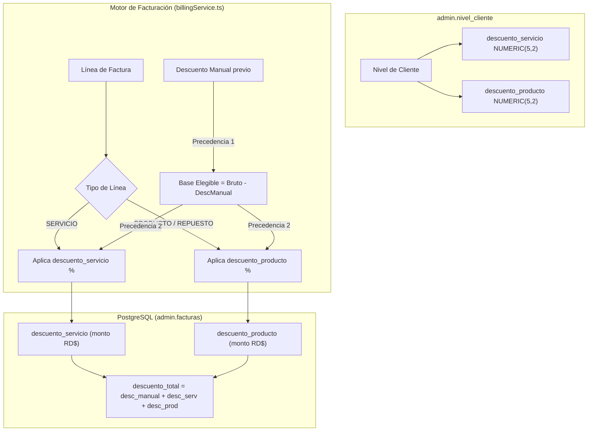

# RIDE LAB — FASE 6.4.16: INFORME DE IMPLEMENTACIÓN INTEGRAL DE DESCUENTOS DIFERENCIADOS POR NIVEL DE CLIENTE

**Proyecto:** Bikers' Fort Core — Ride Lab  
**Rama de trabajo:** `feature/segurid-crm-taller-ajustes-validaciones`  
**Base de datos autorizada:** PostgreSQL TEST local — `127.0.0.1:5432 / bikers_dbtest`  
**Estado:** ✅ APROBADO 100% (20/20 Escenarios Fase 6.4.16 + 187/187 Pruebas Históricas RBAC = 207 Pruebas Totales sin Regresiones)

---

## 1. RESUMEN EJECUTIVO

Se completó con éxito la implementación integral de **descuentos diferenciados por nivel de cliente**, permitiendo configurar y aplicar de forma autónoma dos porcentajes independientes:
- `descuento_servicio`: Porcentaje de descuento aplicable exclusivamente a líneas de tipo `SERVICIO`.
- `descuento_producto`: Porcentaje de descuento aplicable exclusivamente a líneas de tipo `PRODUCTO` y `REPUESTO`.

El cambio sustituyó de forma definitiva el campo monolítico previo `porciento_descuento`, preservando la inmutabilidad de las 176 facturas históricas existentes, garantizando la exactitud matemática y bancaria al centavo, el aislamiento multi-empresa y la vigencia del Modelo B de control de acceso RBAC.



---

## 2. ETAPA 1 — AUDITORÍA TÉCNICA Y DIAGNÓSTICO PREVIO

Antes de aplicar cualquier modificación, se ejecutó una auditoría exhaustiva sobre la base de datos y el código fuente:
1. **DDL de `admin.nivel_cliente`:** Se comprobó que `porciento_descuento` era `NUMERIC(5,2) NOT NULL DEFAULT 0.00` con restricción `chk_nivel_cliente_porciento` (0 a 100).
2. **Dependencias identificadas:**
   - 0 vistas dependientes en PostgreSQL.
   - 0 triggers que referenciaran la columna eliminada.
   - APIs identificadas: `/api/crm/niveles-cliente`, `/api/crm/clientes`, `/api/facturacion/catalogos`, `/api/facturacion/ordenes-facturables`, `/api/facturacion/facturas`.
   - Servicios clave: `billingService.ts`, `billingPdfService.ts`, `billingTypes.ts`.
   - Vistas UI: `ClientLevelsView.jsx`, `CustomerFormDrawer.jsx`, `CustomersView.jsx`, `NewInvoiceView.jsx`, `InvoiceDetailModal.jsx`, `InvoicesView.jsx`, `NewReceptionModal.jsx`, `NewWorkOrderModal.jsx`.
3. **Censo histórico:** 176 facturas emitidas bajo el esquema previo en `bikers_dbtest`. Se definió que estas facturas conservaran `porciento_descuento_servicio = NULL` y `porciento_descuento_producto = NULL`, funcionando como discriminador inequívoco de facturas históricas vs facturas diferenciadas.

---

## 3. ETAPA 2 — MIGRACIÓN 048 (`migrations/048_nivel_cliente_descuentos_diferenciados.sql`)

Se elaboró y aplicó la migración 048 mediante el script oficial de migraciones:
```bash
node scripts/db_migrations.js migrate --env=test
```

### Acciones ejecutadas en PostgreSQL:
1. **En `admin.nivel_cliente`:**
   - Agregada columna `descuento_servicio NUMERIC(5,2) NOT NULL DEFAULT 0.00`.
   - Agregada columna `descuento_producto NUMERIC(5,2) NOT NULL DEFAULT 0.00`.
   - Restricciones CHECK `chk_nivel_cliente_descuento_servicio` y `chk_nivel_cliente_descuento_producto` (valores entre 0.00 y 100.00).
   - Migración de datos: Copiado el valor de `porciento_descuento` en ambos campos para los 3 niveles canónicos existentes (VIP: 15.00%, INTERMEDIO: 5.00%, BASICO: 0.00%).
   - Eliminada la restricción anterior `chk_nivel_cliente_porciento` y la columna `porciento_descuento`.
2. **En `admin.facturas`:**
   - Agregada columna `porciento_descuento_servicio NUMERIC(5,2) DEFAULT NULL`.
   - Agregada columna `porciento_descuento_producto NUMERIC(5,2) DEFAULT NULL`.
   - Agregada columna `descuento_servicio NUMERIC(12,2) NOT NULL DEFAULT 0.00`.
   - Agregada columna `descuento_producto NUMERIC(12,2) NOT NULL DEFAULT 0.00`.
   - Restricciones CHECK de 0 a 100 en porcentajes y `>= 0` en importes de descuento.
3. **Verificación de integridad:**
   - `node scripts/db_migrations.js verify --env=test`: 48 migraciones verificadas, 0 discrepancias de checksum.
   - 176 facturas históricas permanecieron con valores NULL en los nuevos porcentajes e importes históricos intactos.

---

## 4. ETAPAS 3 Y 4 — ACTUALIZACIÓN DE APIs Y MODELOS DE DATOS

| Endpoint / Módulo | Métodos | Cambios Realizados |
| :--- | :---: | :--- |
| `/api/crm/niveles-cliente` | GET, POST | Soporte de `descuento_servicio` y `descuento_producto`. Validación server-side estricta de 0 a 100. Compatibilidad retroactiva tolerante. Auditoría con detalle de ambos porcentajes. |
| `/api/crm/niveles-cliente/[id]` | GET, PUT | Actualización independiente de ambos porcentajes. Validación server-side contra números negativos o > 100. |
| `/api/crm/clientes` | GET, POST | Subconsulta y mapeo de `descuento_servicio` y `descuento_producto` del nivel asociado. |
| `/api/crm/clientes/[id]` | GET | Retorno de ambos porcentajes en los datos del nivel del cliente. |
| `/api/facturacion/catalogos` | GET | Clientes y catálogo de niveles devuelven `descuento_servicio` y `descuento_producto`. |
| `/api/facturacion/ordenes-facturables` | GET | `cliente.descuento_servicio` y `cliente.descuento_producto` devueltos para precálculo en facturación de OT. |
| `/api/facturacion/facturas` | GET, POST | Lista de facturas incluye ambos porcentajes e importes. POST calcula y persiste ambos campos en la cabecera. |
| `/api/facturacion/facturas/[id]` | GET | Retorno de `porciento_descuento_servicio`, `porciento_descuento_producto`, `descuento_servicio` y `descuento_producto`. |
| `src/lib/billing/billingTypes.ts` | Types | Incorporación de las 4 nuevas columnas a la interfaz `FacturaRow`. |

---

## 5. ETAPA 5 — MOTOR DE FACTURACIÓN (`billingService.ts`)

Se rediseñó la lógica de cálculo y asignación de descuentos en `crearFactura` y `obtenerFacturaPorId`:

### Fórmulas Matemáticas y Reglas de Negocio Implementadas:
1. **Consulta Zero-Trust del Nivel de Cliente:**
   El backend consulta directamente `admin.nivel_cliente` filtrando por empresa y validando que `nivel_activo = true`.
2. **Validación de Tipos de Línea:**
   Se admiten estrictamente los tipos `SERVICIO`, `PRODUCTO` y `REPUESTO`.
   - `SERVICIO`: Aplica `porcientoDescuentoServicio`.
   - `PRODUCTO` y `REPUESTO`: Aplican `porcientoDescuentoProducto`.
3. **Precedencia y Protección contra Doble Descuento:**
   El descuento manual de línea se deduce primero del importe bruto:
   $$\text{Base Elegible}_i = \max(0, \text{cant}_i \times \text{precio}_i - \text{descuentoManual}_i)$$
   El descuento del nivel se calcula exclusivamente sobre la base restante:
   $$\text{descNivel}_i = \text{round}\left(\text{Base Elegible}_i \times \frac{\%_{\text{aplicable}}}{100}, 2\right)$$
   $$\text{descTotalLinea}_i = \text{descuentoManual}_i + \text{descNivel}_i$$
4. **Exactitud al Centavo en Base de Datos:**
   Cada línea calcula y persiste su descuento final exacto en `admin.detalle_factura`. La suma de los detalles coincide exactamente con los campos `descuento_servicio`, `descuento_producto`, `descuento_total` y `descuento` de `admin.facturas`.
5. **Persistencia Tolerante a Columnas:**
   Se persisten `porciento_descuento_servicio`, `porciento_descuento_producto`, `descuento_servicio` y `descuento_producto`. En clientes sin nivel o ventas a consumidor final sin nivel, se almacenan como `NULL` en porcentajes y `0.00` en importes.

---

## 6. ETAPA 6 — DOCUMENTOS OFICIALES Y REPORTES (`billingPdfService.ts`)

Se actualizaron los dos generadores oficiales de documentos de venta:
1. **Factura Tamaño Carta / A4:**
   - Detección de factura diferenciada: `isDiferenciado = data.factura.porciento_descuento_servicio !== null`.
   - Si es diferenciada y `descuento_servicio > 0`: Desglosa `Desc. Servicios (${pctServ}%): - RD$ ${montoServ}`.
   - Si es diferenciada y `descuento_producto > 0`: Desglosa `Desc. Productos (${pctProd}%): - RD$ ${montoProd}`.
   - Si es histórica (legacy): Muestra la línea única consolidada `Descuento Nivel (${pctNivel}%): - RD$ ${monto}`.
2. **Ticket Térmico de 80mm:**
   - Mismo criterio condicional con formateo compacto apto para impresoras POS térmicas, respetando el ancho de línea y columnas alineadas a la derecha.

---

## 7. ETAPA 7 — INTERFAZ DE USUARIO (UI / UX)

Se actualizaron los componentes visuales con soporte para temas Claro y Oscuro, microanimaciones y badges semánticos:

1. **`ClientLevelsView.jsx` (Catálogo de Niveles):**
   - Modal de creación y edición con dos inputs numéricos y range sliders (0% a 100%) independientes: **Descuento en Servicios** (azul) y **Descuento en Productos** (esmeralda).
   - Tabla con columnas independientes y badges informativos con iconos representativos (`Wrench` para servicios, `Package` para productos).
2. **`CustomerFormDrawer.jsx` (Formulario de Clientes):**
   - El selector de nivel exhibe ambos porcentajes: `VIP (15% S / 15% P)`.
3. **`CustomersView.jsx` (Gestión de Clientes):**
   - Badges de nivel en tablas, tarjetas móviles y panel lateral de detalles desglosan `15% S / 15% P`.
4. **`NewInvoiceView.jsx` (Creación de Facturas):**
   - Al seleccionar un cliente o una Orden de Trabajo, se visualiza el badge diferenciado.
   - El desglose financiero en tiempo real recalcula de forma separada `descuentoServicioNivel` y `descuentoProductoNivel`.
   - El resumen muestra ambas líneas de descuento de forma independiente cuando sus montos son mayores a RD$ 0.00.
5. **`InvoiceDetailModal.jsx` (Modal de Detalle de Factura):**
   - Desglose contable inteligente: discrimina entre facturas históricas y diferenciadas, mostrando los dos descuentos cuando corresponda.
6. **`InvoicesView.jsx` (Listado de Facturas):**
   - Columna de descuento muestra `(10% S / 5% P)` para facturas diferenciadas y `(10%)` para facturas previas.
7. **Modales de Taller (`NewWorkOrderModal.jsx`, `NewReceptionModal.jsx`):**
   - Despliegue de los porcentajes diferenciados en el badge del cliente seleccionado.

---

## 8. ETAPA 8 — RESULTADOS DE LA SUITE AUTOMATIZADA DE PRUEBAS

### 8.1. Suite Oficial Fase 6.4.16 (`scripts/test_fase_6_4_16_descuentos_diferenciados.js`)
**Ejecutada en:** `127.0.0.1:5432 / bikers_dbtest`  
**Resultado:** ✅ 20/20 Aprobados (100%)

| # | Escenario Evaluado | Resultado | Detalle de Validación |
| :-: | :--- | :---: | :--- |
| **01** | Configuración de nivel con descuentos independientes | ✅ PASS | HTTP 200, DB serv=10.00%, prod=5.00% |
| **02** | Validación server-side de rangos 0-100 en ambos campos | ✅ PASS | Negativo Status=400, Over100 Status=400 |
| **03** | Precisión de decimales NUMERIC(5,2) (7.5% S / 12.25% P) | ✅ PASS | HTTP 200, DB serv=7.50%, prod=12.25% |
| **04** | Facturación solo servicios: aplica servicio, producto = 0 | ✅ PASS | HTTP 201, desc_serv=100.00, desc_prod=0.00, total=900.00 |
| **05** | Facturación solo productos: aplica producto, servicio = 0 | ✅ PASS | HTTP 201, desc_serv=0.00, desc_prod=200.00, total=3800.00 |
| **06** | Facturación mixta (servicios + productos + repuestos) | ✅ PASS | HTTP 201, desc_serv=100.00, desc_prod=150.00, total=3750.00 |
| **07** | Precedencia: descuento manual primero, nivel en base restante | ✅ PASS | HTTP 201, desc_serv_nivel=80.00, desc_total=280.00, total=720.00 |
| **08** | Nivel 0% / 0%: facturación sin descuento de nivel | ✅ PASS | HTTP 201, desc_serv=0.00, desc_prod=0.00, total=900.00 |
| **09** | Nivel asimétrico 0% servicio / 15% producto | ✅ PASS | HTTP 201, desc_serv=0.00, desc_prod=150.00, total=1850.00 |
| **10** | Nivel asimétrico 15% servicio / 0% producto | ✅ PASS | HTTP 201, desc_serv=150.00, desc_prod=0.00, total=1850.00 |
| **11** | Nivel inactivo: cliente no recibe descuento de nivel (0%) | ✅ PASS | HTTP 201, desc_serv=0.00, desc_prod=0.00, total=2000.00 |
| **12** | Cambio dinámico de cliente: recálculo según nivel propio | ✅ PASS | Cliente 1 (10%S/5%P) => desc_serv=100.00, desc_prod=50.00 |
| **13** | Recálculo dinámico por cambio de cantidad y precio | ✅ PASS | subtotal=5500.00, desc_serv=450.00, desc_prod=50.00, total=5000.00 |
| **14** | Protección contra doble descuento (aislamiento base imponible) | ✅ PASS | desc_serv_nivel=20.00, desc_total=820.00, total=180.00 |
| **15** | Facturación desde Orden de Trabajo facturable (OT) | ✅ PASS | HTTP 201, OT=527, desc_serv=50.00, desc_prod=50.00, total=1400.00 |
| **16** | Redondeo bancario: detalle_factura == encabezado facturas | ✅ PASS | Detalle sum=250, Encabezado=250 (serv=100 + prod=150) |
| **17** | Integridad contable: subtotal - descuento + impuesto = total | ✅ PASS | 12 facturas generadas; 100% cumplen la ecuación contable |
| **18** | Inmutabilidad de facturas históricas (176 facturas) | ✅ PASS | Total=176, null_serv=176, null_prod=176, API safe=true |
| **19** | Aislamiento multi-empresa estricto en facturación | ✅ PASS | Acceso de Empresa 2 a factura de Empresa 1 respondió HTTP 403 |
| **20** | Persistencia física completa en PostgreSQL (DDL y CHECKs) | ✅ PASS | nivel_cliente: serv=true, prod=true, dropped_old=true; facturas: cols=4/4 |

### 8.2. Regresión Histórica de Suites RBAC (Fases 6.4.1 a 6.4.14)
**Resultado:** ✅ 187/187 Pruebas Aprobadas (100%)

1. `test_fase_6_4_1_regression.js`: 10/10 PASS (Aislamiento y acceso dashboard)
2. `test_fase_6_4_5_rbac.js`: 24/24 PASS (Motor RBAC y Modelo B)
3. `test_fase_6_4_6_navigation.js`: 26/26 PASS (Smart Home Dispatcher)
4. `test_fase_6_4_8_privilege_escalation.js`: 22/22 PASS (Prevención de escalamiento de privilegios)
5. `test_fase_6_4_9_roles_adicionales.js`: 26/26 PASS (Roles adicionales y migración 047)
6. `test_fase_6_4_10_navigation_sync.js`: 26/26 PASS (Sincronización segura de pantallas y módulos)
7. `test_fase_6_4_13_ui_permissions.js`: 28/28 PASS (Enforcement de permisos UI y cabeceras x-perm-*)
8. `test_fase_6_4_14_qa_rbac.js`: 25/25 PASS (Autorización server-side en usuarios y roles)

### 8.3. Validación de Compilación TypeScript
- Comando ejecutado: `npx tsc --noEmit`
- Resultado: **0 errores**. Tipado estricto verificado en todas las interfaces y archivos `.ts`.

---

## 9. ESTADO DE GIT Y VERIFICACIÓN PREVIA

- **Rama activa confirmada:** `feature/segurid-crm-taller-ajustes-validaciones`
- **Archivos modificados:**
  - `migrations/048_nivel_cliente_descuentos_diferenciados.sql` (nuevo)
  - `scripts/test_fase_6_4_16_descuentos_diferenciados.js` (nuevo)
  - `src/app/api/crm/niveles-cliente/route.ts`
  - `src/app/api/crm/niveles-cliente/[id]/route.ts`
  - `src/app/api/crm/clientes/route.ts`
  - `src/app/api/crm/clientes/[id]/route.ts`
  - `src/app/api/facturacion/catalogos/route.ts`
  - `src/app/api/facturacion/ordenes-facturables/route.ts`
  - `src/app/api/facturacion/facturas/route.ts`
  - `src/app/api/facturacion/facturas/[id]/route.ts`
  - `src/lib/billing/billingTypes.ts`
  - `src/lib/billing/billingService.ts`
  - `src/lib/billing/billingPdfService.ts`
  - `src/components/crm/ClientLevelsView.jsx`
  - `src/components/crm/CustomerFormDrawer.jsx`
  - `src/components/crm/CustomersView.jsx`
  - `src/components/billing/NewInvoiceView.jsx`
  - `src/components/billing/InvoiceDetailModal.jsx`
  - `src/components/billing/InvoicesView.jsx`
  - `src/components/workshop/NewReceptionModal.jsx`
  - `src/components/workshop/NewWorkOrderModal.jsx`
- **Estado de commits:** No se han ejecutado `git commit`, `git push`, ni `git merge`, en estricto cumplimiento de las directrices del proyecto. Queda a la espera de autorización y mensaje de commit específico por parte del usuario.
